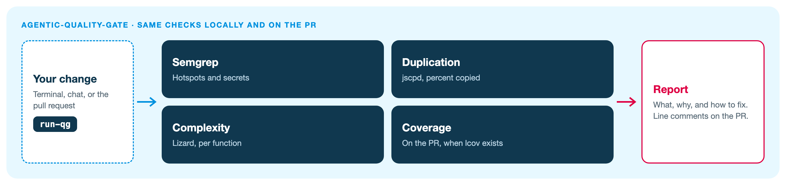

# agentic-quality-gate

Sonar-style checks on your change: security hotspots, secrets, duplication, complexity, and coverage. No AI in this repo.

One of four hubs. The full picture is the [Agentic AppSec overview](https://github.com/pulumamidi-harsha/agentic-review#readme).

## What this repo does



| Where you run it | What you see |
|:-----------------|:-------------|
| Terminal: `run-qg` | Live log, then the report. No pull request needed |
| IDE chat: `run quality gate` | Same checks, then an explanation |
| `git push` | Same checks in a pre-push hook |
| Pull request | Same checks, plus line comments. Coverage runs here when `lcov` exists |

The local command and the pull request use the same engines and the same rules.

## Run it locally

From your app repo. One line installs the `run-qg` command.

macOS or Linux, hub cloned next to the app:

```bash
cd /path/to/my-app && bash ../agentic-quality-gate/scripts/install-app.sh && export PATH="$HOME/.local/bin:$PATH" && hash -r
```

Or from GitHub:

```bash
cd /path/to/my-app && curl -fsSL https://raw.githubusercontent.com/pulumamidi-harsha/agentic-quality-gate/main/scripts/install-app.sh | bash && export PATH="$HOME/.local/bin:$PATH" && hash -r
```

Windows (PowerShell, with Git for Windows and Python 3):

```powershell
cd C:\path\to\my-app; irm https://raw.githubusercontent.com/pulumamidi-harsha/agentic-quality-gate/main/scripts/install-app.ps1 | iex
```

Then:

```bash
run-qg
```

The first run installs Semgrep and is slow. Later runs reuse `~/.cache/agentic-quality-gate`.

In VS Code: Terminal → Run Task… → `run-qg`.

Skip the pre-push hook once with `git push --no-verify`. Skip the pull-request job with the label `skip-quality-gate` or `no-review`.

Rules live in `config/quality-gate.yml` and `config/packages/default.yml`. Pin the workflow to a full commit SHA before production use.
