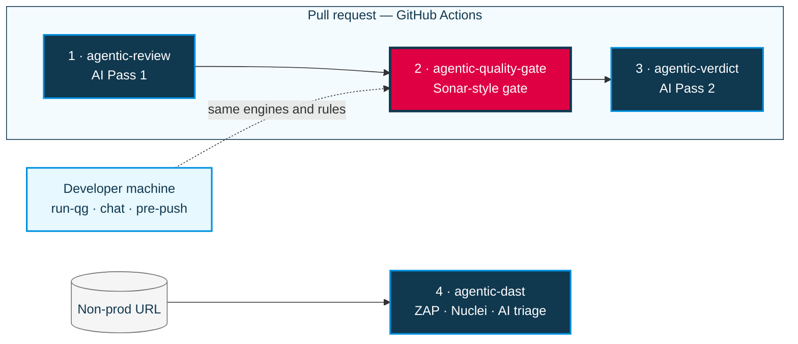

# agentic-quality-gate

SonarQube replacement for pull requests: Semgrep hotspots, duplication %, complexity, coverage, and peer-style PR comments.

**No AI in this hub.** AI review lives in [agentic-review](https://github.com/bayer-int/agentic-review#readme) and [agentic-verdict](https://github.com/bayer-int/agentic-verdict#readme).

## Part of the Agentic AppSec platform

This repo is one of four hubs that together give Bayer teams agentic SAST and DAST checks: open-source scanners, with findings explained and prioritized by AI. For the problem statement, the full architecture diagram and the end-to-end PR flow, see **[Platform overview in agentic-review](https://github.com/bayer-int/agentic-review#platform-overview)**.



<sub>Highlighted in pink: this repo.</sub>

| # | Hub | Role |
|:-:|:----|:-----|
| 1 | [agentic-review](https://github.com/bayer-int/agentic-review#readme) | AI Pass 1: detects the stack, runs lint / test / build, dependency audit, secret and IaC scans |
| 2 | **agentic-quality-gate** (this repo) | Sonar-style gate: security hotspots, secrets, duplication, complexity, coverage. Also runs locally as `run-qg` |
| 3 | [agentic-verdict](https://github.com/bayer-int/agentic-verdict#readme) | AI Pass 2: weighs all evidence, posts the final PR review, approve / request changes, label |
| 4 | [agentic-dast](https://github.com/bayer-int/agentic-dast#readme) | Runtime scans of a live non-prod URL (OWASP ZAP + Nuclei) with AI triage into a sticky Issue |

---

## For developers — one command per app

From your application repo (example: `my-app`), paste **one line** for your OS.

### macOS / Linux

**Hub already next to the app** (best; avoids SSL issues):

```bash
cd /path/to/my-app && bash ../agentic-quality-gate/scripts/install-app.sh && export PATH="$HOME/.local/bin:$PATH" && hash -r
```

**Or from GitHub:**

```bash
cd /path/to/my-app && curl -fsSL https://raw.githubusercontent.com/pulumamidi-harsha/agentic-quality-gate/main/scripts/install-app.sh | bash && export PATH="$HOME/.local/bin:$PATH" && hash -r
```

### Windows (PowerShell)

Needs **Git for Windows** (for `bash`) and **Python 3** on PATH. Same engines as Mac — the gate still runs via Git Bash under the hood.

**Hub already next to the app:**

```powershell
cd C:\path\to\my-app; & ..\agentic-quality-gate\scripts\install-app.ps1
```

**Or from GitHub:**

```powershell
cd C:\path\to\my-app; irm https://raw.githubusercontent.com/pulumamidi-harsha/agentic-quality-gate/main/scripts/install-app.ps1 | iex
```

Then type `run-qg` in that same PowerShell window.

### WSL

Use the macOS/Linux commands inside your WSL distro (not PowerShell).

### Run in the terminal (recommended — live scrolling logs)

```bash
run-qg
```

In **VS Code**: `Terminal → Run Task… → run-qg` (same live log in the Terminal panel).

First run can take a few minutes (Semgrep install + rule packs). Later runs reuse `~/.cache/agentic-quality-gate` and are faster. You will see lines like `→ semgrep`, pack names, etc. while it works.

### Run in Agent chat (short)

```text
run-qg
```

Chat is good for **explain / fix** after the scan. Some Copilot/Agent UIs stay quiet until a tool call returns — for a npm-style live feed, use the **terminal** command above.

### Push / PR (automatic)

| When | What runs |
|------|-----------|
| **git push** | Local pre-push hook (`run-qg --strict`) |
| **Pull request** | GitHub `PR Quality Gate` (merge authority) |

Skip local hook once (not recommended): `git push --no-verify`.  
Pin workflow `uses:` / `pipeline_ref` to a **full SHA** before production.

---

## What runs where

| Check | Terminal / chat | git push | GitHub PR |
|-------|-----------------|----------|-----------|
| Semgrep hotspots | yes | yes | yes |
| Duplication % | yes | yes | yes |
| Complexity | yes | yes | yes |
| Coverage | no | no | when `lcov` is present |
| Line comments on the PR | no | no | yes |

Languages and stacks: TypeScript/JavaScript/React/Node, Python, Go, Java/Spring, Kotlin, C#, Ruby, PHP, Rust, Terraform, Docker, Kubernetes/Helm, Ansible, Bash, SQL, and more.

Policy: `config/packages/default.yml`, `config/packages/default/rules/`, `config/quality-gate.yml`. CI fails closed if an enabled scanner cannot run.

Skip labels (CI): `skip-quality-gate`, `skip-ai-review`, or `no-review`.
